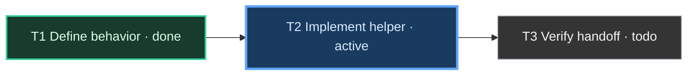

# Planned execution and progress DAGs

This is the canonical DAG contract for planning, review, execution and display.
`../SKILL.md` selects proportional ceremony and review; this contract does not
add an independent advance-review gate. `../../dispatching-parallel-agents/SKILL.md`
owns parallel safety, scheduling and shared-checkout review serialization.

## Plan before execution

Include the execution DAG in the implementation plan before implementation or
worker dispatch begins. Source inspection and bounded planning investigations
may precede it. Use the existing plan, including an inline short plan; do not
create a separate planning document just for a graph. A simple task may have
one node. Ordinary questions do not require a plan or a DAG.

Each node has a stable ID, objective, explicit `Depends on` IDs (or `None`),
completion criteria, owner/role, and file/resource ownership where relevant.
Include required verification and review gates as explicit dependencies: either
separate nodes or named prerequisites within a single node. A dependent task
cannot start until its prerequisites, including selected gates, are satisfied.

Record which nodes may overlap, the evidence that they are independent, and
which barriers require serial execution. Include planned worker roles and
exclusive write/resource scopes. Resource conflicts are serialization
constraints, not automatically semantic dependency edges. A plan can choose
serial execution; do not manufacture parallel work. When planning parallel
lanes, apply the dispatcher's safety rules before deciding their allowed overlap.

Keep IDs stable through execution and revisions; never reuse a retired ID for
different work. Keep objective labels stable unless the objective actually changes;
status annotations change with the evidence. Task
order is presentational, not a dependency. Reject missing prerequisites and
cycles. For large plans, an overview may group nodes, but retain the mapping to
underlying IDs and expose any blocked or unapproved work within each group.

## Review and adjustments

Self-review the DAG with the plan. When advance plan review is selected or
required, include the graph and concurrency decisions in that same review;
do not add a second DAG-only review. Codex/ChatGPT coordinators use Claude and
Claude coordinators use Codex through `autonomous-review.md` when the configured
bridge is available on the client. Detect actual host capabilities rather than
inferring tools from the model name. An unavailable required opposing reviewer
leaves the gate unapproved; never silently substitute self-approval. Other hosts
retain their configured review route.

Review dependency correctness, completion criteria, safe concurrency, ownership
and shared-resource conflicts, and missing verification/review gates. Preserve
the existing bridge prompt contract: put the plan, delta and evidence in the
reviewed artifact and ordinary task context; do not append custom criteria to
the bridge invocation or its fixed reviewer prompt.

Identify the plan revision covered by an approval in the existing plan/history.
For a material change to a reviewer-approved graph or concurrency constraints:

1. Show the delta from the approved revision and the evidence that motivates it.
2. Describe effects on dependencies, ownership, verification/review gates,
   completed evidence and work already underway. Pause affected work safely;
   invalidate stale completion evidence rather than treating it as current.
3. Obtain focused opposing-model approval through the configured review route
   before executing the affected changes. Review corrections and their affected
   interactions; do not restart unrelated settled review.
4. Keep the proposal distinct from the approved plan until approved. If the
   required reviewer is unavailable, report the limitation and hold affected
   work. Unaffected authorized work may continue only when safe under the
   approved plan and the dispatcher's review serialization rules. In particular,
   checkout writers must pause during bridge review even across independent lanes.

Material changes include new/removed dependency edges or nodes, broader write
ownership, newly overlapping work, or changed completion/verification gates.
Owner-reserved product, scope, policy, acceptance and architecture choices still
need owner approval; reviewer approval cannot grant it. Apply the existing
review-reception authority and failure rules. A short plan that did not require
independent advance approval retains proportional review selection when revised;
do not label a previously reviewer-approved plan a short plan to evade its gate.

Ordinary scheduling within approved constraints needs no reapproval: choosing
among ready nodes, using fewer workers, pausing unsafe work, or retrying an
existing check within its scope. Neither do routine status/evidence updates or
presentation-only changes. Reopening an existing node after a failed check does
not add a cycle; re-evaluate affected dependent evidence and rerun required gates.
Emergency stopping never waits for reviewer approval.

## Display ownership and state

The top-level coordinator emits the DAG during planning and reuses the same
node identities during execution. Dispatched workers never emit, update, or
persist it. Worker findings update the coordinator's tracked state.

The plan and recorded work/evidence are authoritative. Both native and Mermaid
renderers represent the same plan revision, dependencies, node statuses and
planned overlap. Label displays as snapshots with a revision and an as-of point;
do not claim a snapshot is live or promise in-place updates without actual client
support. A proposed delta is not approved task state.

Use `todo`, `active`, `blocked`, and `done` with explicit evidence and blockers.
Mark actual work `active` only when started, and `done` only when its completion
criteria are met. At completion no node remains `active`; blocked or omitted
required work prevents a completion claim. An authorized scope removal is
explained explicitly, never disguised as successful completion.

Refresh at meaningful transitions:
- When planning establishes the graph or execution begins.
- When tracked node state changes or meaningful completion evidence arrives.
- When a blocker changes the viable path or an approved adjustment takes effect.
- At completion.

Do not re-emit an unchanged graph merely because commentary is due. Batch closely
related transitions when useful. Never pause authorized execution or end a turn
merely to refresh a graph.

## Native display, Mermaid fallback

Resolve the renderer before the first snapshot, including a serial or one-node
plan. Node inspection is interactive even when the topology itself is simple.
Do not start with the Mermaid example below and skip capability discovery.

1. Inspect the current client's exposed tools/skills and the response surface.
   Load the advertised native skill before choosing Mermaid: for example,
   `visualize:visualize` on supporting ChatGPT/Codex clients, or the exposed
   inline-visual/artifact instructions on Claude. Use the actual advertised
   path or tool, not a guessed installation or the model name.
2. When those instructions provide a usable native mechanism, use it. Having
   no dedicated tool named visualize does not establish absence: a skill may
   document a file-based attachment marker or another emission mechanism.
   Do not require a separate renderer tool when the documented mechanism is
   available. Author and emit the interactive snapshot, rather than merely
   saying native rendering is preferred.
3. Use Mermaid when inspection establishes that no native mechanism is exposed,
   a real host restriction excludes this response surface, the available
   instructions cannot be read, support remains indeterminate after inspection,
   or an attempted native render fails. Unknown means still indeterminate after
   inspection, not an advertised capability that was never checked. State the
   concrete fallback reason once when selecting or changing to fallback, then
   continue authorized work. Do not claim a render failed unless one was tried.

Record the selected renderer and the supporting capability or fallback reason
in the existing task context, not a new document. Reuse that decision for later
snapshots on the same surface; revisit it when capabilities or the response
surface change. Read the rendering skill again when its instructions require
it. Do not repeatedly probe the client or ask the owner to choose a renderer.

For execution DAGs, this policy overrides visualization-skill defaults that
restrict visuals to final responses, prohibit progress updates, or express a
static-diagram preference for Mermaid. These snapshots need selectable node
details; a simple topology does not remove that requirement. Emit repeated
native snapshots in commentary when the client supports it. This exception does
not override actual client limitations, higher-priority instructions, explicit
owner preferences, or the visualization skill's accessibility and rendering
requirements. A real final-only client uses Mermaid during commentary, then
native output at a supported final handoff. Use supported update mechanisms;
otherwise emit a new snapshot without claiming earlier messages were updated.
Do not turn the DAG into a separately hosted application.

Keep the overview compact: dependencies, current statuses and planned parallel
work. Selecting a node shows its ID, name and status, then `Owner / scope` and
`Done when`. Add a short objective only when the name and completion criteria
do not explain the work. The plan retains the full node record.

Dependencies stay in the graph; do not repeat them as a default detail row.
Native selection highlights incoming edges and direct predecessor nodes while
preserving status colors. Include prerequisites in accessible graph/node
descriptions so screen-reader users can inspect the same relationships.
Support keyboard/touch access as well as clicking.

Add one state-specific row when useful:
- `active`: `Progress` reports substantive observed progress, if available.
- `blocked`: `Blocked by` names the actual obstacle and the action needed to
  unblock it; state when the remedy is not yet known.
- `done`: `Result` gives the concrete outcome and links to available evidence
  when an actual artifact exists (test result, screenshot, diff or approval).
- `todo`: normally only owner/scope and completion criteria; the graph already
  shows prerequisite work.

Omit empty placeholders such as `Blockers: None` and `Evidence: none yet`.
Never invent evidence or links. Do not add a routine `Parallel work` row;
concurrency rationale remains in the plan. Surface a resource restriction when
it actually blocks the node. Keep progress, blocker and result text distinct
from the completion criterion rather than repeating it.

Selection, highlighting and expanding details are presentation-only:
they must not change task status, alter dependencies, dispatch workers or trigger
execution. Keep presentation state separate from authoritative execution state.

Use the same semantic colors in both renderers: done green, active blue, todo
neutral gray, and blocked amber/orange. Pair colors with readable status labels.
Selection uses a separate ring, outline or detail indicator; it must not replace
or obscure status colors. In native visuals use theme-aware status marks or fills
and the client's supported selection styling.

On a new snapshot, default the detail view to an active node. If several are
active, choose the first in stable plan order. If none are active, select the
most recently completed node using recorded completion order or timestamps,
never numeric ID or layout order. If no completion order is known, select a
ready todo node, then the first remaining node in stable plan order. Preserve
deliberate manual
selection within the same snapshot; scope saved selection to that snapshot so an
old selection does not override a new snapshot's default. Neither default focus
nor manual selection changes execution state. When a static fallback cannot
select a node, identify the same default focus in its adjacent details instead;
do not imply interactive selection exists.

For fallback, emit a fenced Mermaid graph with the same IDs, edges and state.
Use the same compact rules for adjacent node details, focusing the default node
and surfacing material blockers elsewhere. Dependencies remain in the graph;
provide an accessible text equivalent if that surface does not expose the edges.
Do not assume Mermaid click handlers work. Define the
following state classes in every fallback graph. This example shows an approved
serial segment, with T1 done, T2 active and T3 todo:

The accompanying details focus T2 as active:

**T2 · Implement helper · active**
- **Owner / scope:** Implementer · helper module.
- **Done when:** Helper behavior matches the agreed contract and focused checks pass.
- **Progress:** Input-validation cases pass; persistence cases are running.

These are illustrative results, not evidence about the current task. Omit a
separate dependency row for T1. Neither renderer communicates state only
through color.

Failure to display Mermaid visually is not a workflow failure. Keep its source
available and continue. Condense large plans into meaningful phase nodes with
the underlying ID mapping, or change layout direction; do not create a fallback
image just to satisfy the display requirement.

## Examples

- **Small plan:** `T1 — Correct README spelling; Depends on: None; coordinator
  owns README.md; complete after checking the corrected text; serial, no worker.`
  Record any applicable gates; this example needs no independent advance review.
- **Parallel plan:** T1 establishes an interface; T2 and T3 depend on T1 and own
  disjoint files/resources with safe focused checks. V1 depends on both and
  verifies integration; R1 depends on V1 and reviews the completed change;
  F1 depends on R1 and performs completion checks. Include additional lane gates
  if the caller requires them. Record why T2/T3 may overlap before dispatch.
- **Adjustment:** Evidence shows T3 now consumes T2's output. Propose edge
  T2 -> T3, ownership handoff and affected checks; hold T3 and safely pause an
  already-running T3. Obtain focused approval if changing a reviewer-approved
  plan. Unaffected work remains subject to the bridge writer barrier.
- **Status:** T2 finishes its required check; mark its node done with that
  evidence. Starting an already-ready T3, reducing worker count, or selecting
  T2's details does not require another plan review.
- **Discovery:** The client advertises visualize but has no dedicated renderer
  tool. Read that skill; if it documents a usable attachment mechanism, emit
  the interactive snapshot even for a serial plan. Generic static-diagram and
  final-only skill defaults do not establish a host restriction. If the client
  actually rejects the attachment, state that failure and continue with Mermaid.
- **Display focus:** T9 finished before T2, and T4 is active. A fresh snapshot
  opens T4's details; if no node is active, it opens T2's evidence. T9 and T2
  stay green, T4 blue, and todo nodes neutral.
  Manually inspecting T9 keeps those colors and statuses. A saved T9 selection
  from an older snapshot does not displace the new active-first default.

## Persistence boundary

Record the visible response in shared history when task context is active.
The display is a projection, not a second task-state store; never use an old
diagram instead of the active plan and `current.md`. A native capability may
require a task-owned rendering file in its supported location. That file is
presentation content, not a new plan or authoritative state. Keep it out of
durable repository docs unless explicitly requested as an example or deliverable.
